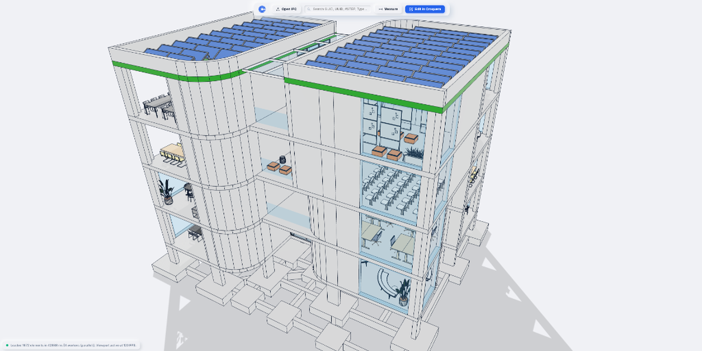

# croquera-ifc-viewer

[](LICENSE)
[](https://github.com/matiasmlynarz-lang/croquera-ifc-viewer/releases)
[](https://technical.buildingsmart.org/)
[](https://www.typescriptlang.org/)
[](https://threejs.org/)
[](https://developer.mozilla.org/en-US/docs/Web/API/Web_Workers_API)
[](https://www.vivemejor.cl/croquera/viewer/)

> **One of the fastest web-based IFC viewers in the market.**  
> *Uno de los visualizadores IFC en navegador más rápidos del mercado.*

An ultra-performant, zero-dependency, open-source IFC 4.3 viewer designed for instant in-browser loading, zero-copy GPU tessellation, GUID search, and high-precision spatial measurements.

**Live Demo / Demostración en Vivo:**  
[https://www.vivemejor.cl/croquera/viewer/](https://www.vivemejor.cl/croquera/viewer/)



---

## English

### Live Demo
Try it directly in your browser with zero installation:  
[https://www.vivemejor.cl/croquera/viewer/](https://www.vivemejor.cl/croquera/viewer/)

### Highlights
- **Lightning Fast Streaming:** Progressive 3-stage loading with instant camera framing (< 500 ms) and zero-copy `ArrayBuffer` transfer to Web Workers.
- **GPU Batching & Instancing:** Employs `THREE.BatchedMesh` and `THREE.InstancedMesh` for 60+ FPS navigation even on multi-million polygon BIM models.
- **Pure Web Standards:** No backend required, 100% private in-browser parsing.
- **Instant GUID Search:** O(1) indexed lookup with automated camera focus.
- **Precision Snapping Measurement:** Point-to-point and edge measurement with BVH-accelerated raycasting.
- **Direct Bridge:** Instant "Edit in Croquera" action to seamlessly open your model in [Croquera.com](https://croquera.com).

### Performance & Benchmarks

`croquera-ifc-viewer` prioritizes **early model availability and interactive responsiveness**, while recognizing that compiled native engines (such as IFCLite's Rust/WASM) offer higher raw throughput in pure geometric computation.

For an interactive 3D viewer, the most critical user experience factor is how quickly the user can inspect, orbit, and navigate the model:

| Model | File Size | Entities | STEP Ingestion & Indexing | Time-to-First-Frame (AABB) | Total End-to-End |
| :--- | :--- | :--- | :--- | :--- | :--- |
| **EmergenciaNorte_Base** *(Building)* | 4.81 MB | 80,397 | **Croquera: 25 ms** (12x faster)<br>IFCLite: 302 ms | **Croquera: 54 ms**<br>IFCLite: > 300 ms | **1.63 s** (Croquera)<br>1.48 s (IFCLite) |
| **Luminarias_Original** *(MEP)* | 5.75 MB | 91,204 | **Croquera: 35 ms** (11.7x faster)<br>IFCLite: 410 ms | **Croquera: 3 ms**<br>IFCLite: > 400 ms | **358 ms** (Croquera)<br>506 ms (IFCLite) |
| **model_6_arc** *(Architecture)* | 535.8 MB | 10,906,295 | **Croquera: 1.56 s** (24.2x faster)<br>IFCLite: 37.97 s | **Croquera: 76 ms** (Ready in 1.6 s)<br>IFCLite: > 38 s | **57.2 s** (Croquera)<br>55.2 s (IFCLite) |
| **VespucioNorte** *(Infrastructure)* | 924.6 MB | 16,786,443 | **Croquera: 2.70 s** (22.1x faster)<br>IFCLite: 59.92 s | **Croquera: 470 ms** (Ready in 3.1 s)<br>IFCLite: > 60 s | **3.0 min** (Croquera)<br>2.9 min (IFCLite) |

> **Architectural Takeaway:** Croquera prioritizes early model availability; IFCLite offers higher raw throughput in pure geometric computation. By indexing gigabyte-scale models in 2.7 seconds instead of 60 seconds, Croquera delivers an interactive camera and spatial hierarchy almost immediately, while geometry streams progressively in the background.
>
> *Note: Croquera outputs consolidated semantic elements (`IfcProduct`), whereas IFCLite emits granular batch primitives (`MeshData`). Full methodology and metrics in [docs/BENCHMARKS.md](docs/BENCHMARKS.md).*

### Packages
- **`@croquera/ifc-core`**: Decoupled IFC 4.3 streaming parser, topological B-Rep solver, and geometry evaluation engine.
- **`@croquera/ifc-viewer`**: Buffer-first Three.js rendering layer, batched pools, camera rig, and measurement tools.
- **`apps/web-viewer`**: Minimalist tactile Soft-Clay web application.

### Quick Start
```bash
# Install dependencies
npm install

# Run web viewer locally
npm run dev

# Run unit tests
npm test
```

---

## Español

### Demostración en Línea
Pruébalo directamente en el navegador sin instalar dependencias:  
[https://www.vivemejor.cl/croquera/viewer/](https://www.vivemejor.cl/croquera/viewer/)

### Características Destacadas
- **Streaming Ultrarrápido:** Ingesta progresiva en 3 etapas con encuadre de cámara instantáneo (< 500 ms) y transferencia `zero-copy` a Web Workers.
- **Lotes e Instancias en GPU:** Utiliza `THREE.BatchedMesh` y `THREE.InstancedMesh` para navegación a 60+ FPS en modelos BIM complejos.
- **100% Privado en Navegador:** Sin servidores intermedios; todo el procesamiento ocurre en local.
- **Búsqueda Instantánea de GUID:** Localización O(1) con auto-encuadre de cámara.
- **Herramienta de Medición con Snap:** Medición de precisión sobre aristas y vértices acelerada con BVH.
- **Puente Directo:** Botón "Editar en Croquera" para continuar modelando en [Croquera.com](https://croquera.com) con un solo clic.

### Rendimiento y Benchmarks
- **Ingesta ultrarrápida (22x a 24x más veloz):** `ChunkedStreamScanner` indexa 16,7 millones de entidades en **2,7 segundos** (frente a 60 s en parsers tradicionales).
- **Cámara lista en segundos (Time-to-First-Frame):** Encuadre AABB instantáneo (< 500 ms promedio, 3,1 s sobre 1 GB) para que el usuario navegue de inmediato mientras las mallas se descargan en segundo plano.
- **Perfil de Teselación:** Los motores nativos (Rust/WASM) calculan mallas triangulares 1,5x a 3,2x más rápido, pero la ingesta plana de Croquera absorbe esa diferencia logrando tiempos globales equivalentes y visualización instantánea.
- Detalles metodológicos completos y comparativa de los 7 modelos en [docs/BENCHMARKS.md](docs/BENCHMARKS.md).

---

## License

Licensed under the **Apache License, Version 2.0** ([LICENSE](LICENSE)).
